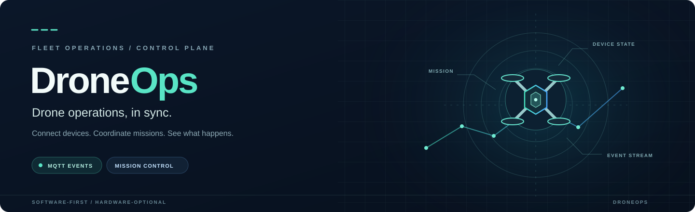

<p align="center">
  
</p>

<p align="center"><strong>A software control plane for connected drone devices and mission workflows.</strong></p>

DroneOps brings device status, mission requests and operational events into one backend. An Express API coordinates with MQTT-connected devices, records state in MongoDB, and tracks command acknowledgements. A Node.js simulator lets you exercise the workflow without hardware.

DroneOps manages high-level operational requests. Flight stabilization, navigation and other flight-critical functions remain with the flight controller. The simulator and its acknowledgements are not evidence of physical flight or safety certification.

## Why DroneOps

- **See the fleet:** Query the latest device state and identify offline or stale devices.
- **Coordinate work:** Reserve an eligible device for a mission and track each request through acknowledgement.
- **Investigate outcomes:** Search operational history, inspect alerts and replay recorded events into a diagnostic snapshot.
- **Develop without hardware:** Run the same MQTT workflow with a software simulator.

## Features

| Capability | What is available |
| --- | --- |
| Device registry | Register devices with identities and capabilities; view connectivity, operational state and last-seen time. |
| MQTT communication | Ingest validated status updates, use per-device topic permissions, and mark unexpected disconnects through session-bound last wills. |
| Mission orchestration | Create and inspect missions, atomically reserve eligible devices, and request start, pause, resume, completion or cancellation. |
| Command governance | Allowlisted requests carry unique IDs, correlation IDs and expiry times. Mission state changes only after a matching device acknowledgement. |
| Reliability | Stale-state detection, duplicate handling, persistent simulator state, and late-acknowledgement reconciliation protect the workflow across reconnects. |
| Operational visibility | Query device events, mission and command audit records, alerts, and read-only device or mission replays. |
| Access control | JWT authentication with admin and operator roles; device registration is restricted to admins. |
| Read-only AI assistant | Optional OpenAI-compatible chat endpoint uses bounded fleet, device, mission and event lookup tools. It cannot change state or dispatch commands. |

**Built with:** Node.js, Express, MongoDB, Mongoose, MQTT.js, Eclipse Mosquitto, Zod and Docker Compose.

## Installation

### Prerequisites

- Node.js 24 and npm
- Docker with Docker Compose
- Bash and `curl`

The supplied MongoDB and MQTT ports bind to `127.0.0.1`. The MongoDB configuration has no authentication and is intended for local development only.

### 1. Install dependencies

```sh
git clone https://github.com/arnav7897/DockOps-AI-Powered-Drone-Fleet.git
cd DockOps-AI-Powered-Drone-Fleet
npm ci
```

### 2. Create broker accounts

Create the `backend` account and a simulator account named `drone-1`. Each command prompts for a password. The `-c` option creates a new password file; do not use it if you already have one, because it replaces the file. For an existing file, omit `-c` when adding or updating `backend`.

```sh
docker run --rm -it -v "$PWD/mosquitto/config:/mosquitto/config" \
  --entrypoint mosquitto_passwd eclipse-mosquitto:2 \
  -c /mosquitto/config/passwd backend

docker run --rm -it -v "$PWD/mosquitto/config:/mosquitto/config" \
  --entrypoint mosquitto_passwd eclipse-mosquitto:2 \
  /mosquitto/config/passwd drone-1
```

Device usernames must match their registered device IDs. The `backend` identity is reserved for the API. The password file is Git-ignored.

### 3. Configure and start

Create `.env` from the example if it does not already exist:

```sh
test -e .env || cp .env.example .env
```

Edit `.env` to set a private `JWT_SECRET` of at least 32 characters, then uncomment and set the MQTT values below. Use the password chosen for the `backend` broker account. Keep `.env` private and use shell-safe values when sourcing it.

```dotenv
MQTT_URL=mqtt://127.0.0.1:1883
MQTT_USERNAME=backend
MQTT_PASSWORD=your_backend_password
```

The AI assistant is optional. To enable it, set `AI_API_BASE_URL` to an HTTPS OpenAI-compatible API base URL, plus `AI_API_KEY` and `AI_MODEL`. Keep the key only in `.env`; without all three values, `/api/v1/ai/chat` returns `503`.

Start MongoDB and Mosquitto, load the environment, and run the API:

```sh
docker compose up -d --wait
set -a
. ./.env
set +a
npm start
```

Leave the API running. In another terminal, check the public health endpoint:

```sh
curl http://127.0.0.1:3000/api/v1/health
```

The default API port is `3000`. The Compose MongoDB service runs as a single-node replica set because reservation and audit operations use transactions.

## Usage guide

The following walkthrough uses `drone-1` and a `survey` mission. Run the API commands from the project directory in a terminal where `.env` has been loaded as above.

### 1. Create a local development token

DroneOps verifies externally issued HS256 tokens; it does not provide user management or a token-issuance endpoint. For local testing, create a short-lived admin token with the configured secret:

```sh
set -a
. ./.env
set +a
export ADMIN_TOKEN="$(node -e 'console.log(require("jsonwebtoken").sign({role:"admin"}, process.env.JWT_SECRET, {algorithm:"HS256", subject:"local-admin", issuer:"droneops", audience:"droneops-api", expiresIn:"1h"}))')"
```

Operators and admins can manage missions and read operational data. Only admins can register devices. Treat the secret and token as credentials; the example token is for local development.

### Ask the read-only assistant

When the optional AI provider is configured, ask an operational question with the authenticated chat route:

```sh
curl -fsS -X POST http://127.0.0.1:3000/api/v1/ai/chat \
  -H "Authorization: Bearer $ADMIN_TOKEN" \
  -H 'Content-Type: application/json' \
  -d '{"message":"Which devices are offline or stale?"}'
```

The response includes the answer and source IDs returned by backend tools. Requests are limited to 10 per user per minute per API process. The assistant only reads data; it cannot create, assign, approve or dispatch missions. Use shared rate limiting before running multiple API instances.

### 2. Register a device

```sh
curl -fsS -X POST http://127.0.0.1:3000/api/v1/devices \
  -H "Authorization: Bearer $ADMIN_TOKEN" \
  -H 'Content-Type: application/json' \
  -d '{"deviceId":"drone-1","name":"Survey simulator","capabilities":["survey"]}'
```

### 3. Start the simulator

In a separate terminal, change to the project directory and enter the simulator account password when prompted:

```sh
read -rsp 'Simulator MQTT password: ' DEVICE_PASSWORD; echo
DEVICE_ID=drone-1 MQTT_USERNAME=drone-1 MQTT_PASSWORD="$DEVICE_PASSWORD" \
  MQTT_URL=mqtt://127.0.0.1:1883 node simulator/device.js
```

Leave it running. It publishes status and accepts allowlisted mission requests. Its state and acknowledgements are stored in the Git-ignored `.simulator-state/` directory; set `DEVICE_STATE_DIR` to use another persistent directory. Run one simulator per device.

Back in the API-command terminal, confirm the device is online and not stale:

```sh
curl -fsS http://127.0.0.1:3000/api/v1/devices \
  -H "Authorization: Bearer $ADMIN_TOKEN"
```

### 4. Create and run a mission

Create a mission and capture its ID:

```sh
MISSION_ID="$(curl -fsS -X POST http://127.0.0.1:3000/api/v1/missions \
  -H "Authorization: Bearer $ADMIN_TOKEN" \
  -H 'Content-Type: application/json' \
  -d '{"type":"survey","parameters":{}}' \
  | node -pe 'JSON.parse(require("fs").readFileSync(0, "utf8")).missionId')"
```

Assign the simulator. Its reported capability must match the mission type, and its latest state must be online, idle, unreserved and fresh:

```sh
curl -fsS -X POST "http://127.0.0.1:3000/api/v1/missions/$MISSION_ID/assign" \
  -H "Authorization: Bearer $ADMIN_TOKEN" \
  -H 'Content-Type: application/json' \
  -d '{"deviceId":"drone-1"}'
```

Request a start and capture the command ID:

```sh
COMMAND_ID="$(curl -fsS -X POST "http://127.0.0.1:3000/api/v1/missions/$MISSION_ID/start" \
  -H "Authorization: Bearer $ADMIN_TOKEN" \
  | node -pe 'JSON.parse(require("fs").readFileSync(0, "utf8")).commandId')"
```

Inspect the command and mission. If the command is still pending, retry the query after the simulator responds:

```sh
curl -fsS "http://127.0.0.1:3000/api/v1/commands/$COMMAND_ID" \
  -H "Authorization: Bearer $ADMIN_TOKEN"

curl -fsS "http://127.0.0.1:3000/api/v1/missions/$MISSION_ID" \
  -H "Authorization: Bearer $ADMIN_TOKEN"
```

Use `POST /api/v1/missions/:id/pause`, `/resume`, `/complete` or `/cancel` for the corresponding transition. A command request returns HTTP `202`; the mission changes state after a matching acknowledgement. A draft or undispatched reservation can be cancelled directly.

### 5. Inspect operations

```sh
curl -fsS http://127.0.0.1:3000/api/v1/alerts \
  -H "Authorization: Bearer $ADMIN_TOKEN"

curl -fsS "http://127.0.0.1:3000/api/v1/events?missionId=$MISSION_ID" \
  -H "Authorization: Bearer $ADMIN_TOKEN"

curl -fsS "http://127.0.0.1:3000/api/v1/missions/$MISSION_ID/replay" \
  -H "Authorization: Bearer $ADMIN_TOKEN"
```

Event queries accept `deviceId`, `missionId`, `correlationId` and `kind=device|command|audit` filters and return up to 100 records. Device history and replay are available at `/api/v1/devices/:id/events` and `/api/v1/devices/:id/replay`. Replays read up to 1,000 events into an isolated diagnostic snapshot; they do not send commands or change stored state. Mission replays flag incomplete audit histories.

## Operational notes

- `STALE_AFTER_MS` controls the freshness threshold and defaults to 60,000 ms. Each simulator sends a heartbeat every 30 seconds.
- A timed-out or uncertain command keeps its device reserved. A matching late acknowledgement can reconcile it when the authenticated device reports a time within the command's validity window; this relies on the device clock. There is no manual recovery workflow when no acknowledgement arrives.
- The simulator retains up to 1,000 acknowledgements and fails closed at that limit. Its persisted state and broker account are for simulation, not flight control.
- The backend uses a persistent MQTT session. Run one backend per `MQTT_CLIENT_ID`; the default is `droneops-backend`. The Compose broker stores session data in a named volume.
- Audit entries cover transitions recorded after audit support was added; earlier activity is not backfilled.

## Testing

```sh
npm test
```

The default run skips tests requiring external services. To include MongoDB integration tests, set `TEST_MONGODB_URI` to a dedicated replica set URI. To also run the broker test, set `TEST_MQTT_URL`, `TEST_MQTT_BACKEND_PASSWORD` and `TEST_MQTT_DEVICE_PASSWORD` for a dedicated broker with `backend` and `drone1` accounts using the supplied ACL. These tests create and drop temporary databases and use a temporary simulator state directory.
